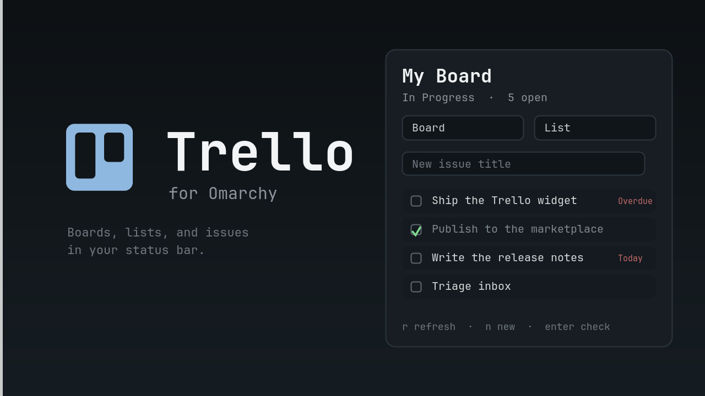

# Trello for Omarchy

A [Trello](https://trello.com) bar widget for [Omarchy](https://omarchy.org/).
Pick a board and a list, check issues off, and add new ones from a native
quickshell panel — without opening a browser.



## What it does

- **One bar glyph.** Shows the number of open issues in the selected list and
  keeps it fresh on a timer.
- **Pick a board and list.** Searchable dropdowns over every open board on
  your account and every list on the chosen board. The choice is remembered.
- **Check issues off.** A checkbox archives the card in Trello. Turn on
  *show done* (`d`) to see completed cards too, struck through, and restore
  them with the same checkbox.
- **Create issues.** Type a title, optionally add a description, and press
  Enter. The card lands at the top of the selected list.
- **Due dates at a glance.** Cards with a due date show it; overdue dates are
  tinted with the theme's urgent color.

Everything runs locally. The only network traffic is to `api.trello.com`.

## Requirements

- Omarchy (Quattro / Omarchy shell 4.x) with the Quickshell shell.
- `curl`, which ships with the base system.

## Install

```sh
omarchy plugin add https://github.com/postjohannes/omarchy-trello-plugin.git --enable
```

The installer places the widget in the bar's right section by default. Move it
anywhere with:

```sh
omarchy bar move io.github.postjohannes.trello --section left
```

## Connect your account

Trello's REST API authenticates with a personal **API key** plus a **token**.

1. Open the widget and click **1 · Get API key**. Trello's developer page
   (<https://trello.com/app-key>) shows your personal **API key**; paste it
   into the setup form.
2. Click **2 · Get token**. Trello asks you to authorize read/write access and
   then shows a **token**. Copy it.
3. Paste the token and click **Connect**.

Both values are stored in `~/.config/omarchy/trello.json`, which the widget
keeps at mode `0600` because it holds a token. It only ever leaves your
machine to authenticate with Trello.

## Usage

Bar glyph:

- **Left click** opens the panel.
- **Right click** refreshes.
- **Middle click** opens the selected board in your browser.

Panel:

- Board and list dropdowns select what the widget shows.
- The title field creates a new issue; **Enter** submits.
- `j` / `k` move the issue cursor, **Enter** or **Space** checks the selected
  issue off.
- `n` jumps to the new-issue field, `d` toggles completed cards, `r`
  refreshes, `Esc` closes, `Tab` moves to the neighboring bar panel.

## Configuration

Settings live in `~/.config/omarchy/trello.json`:

| Key | Default | Meaning |
| --- | --- | --- |
| `apiKey` | `""` | Trello API key |
| `token` | `""` | Trello authorization token |
| `boardId` | `""` | Selected board |
| `boardName` | `""` | Cached board name |
| `listId` | `""` | Selected list |
| `listName` | `""` | Cached list name |
| `refreshIntervalSec` | `300` | How often the bar count refreshes (30–3600) |
| `showCompleted` | `false` | Also list archived (done) cards |

The panel's gear button reopens the setup form to change credentials.
**Disconnect** clears the stored key and token.

## Remove

```sh
omarchy plugin remove io.github.postjohannes.trello
```

This does not delete `~/.config/omarchy/trello.json`; remove it by hand if you
want to forget the credentials.

## License

[MIT](LICENSE)
